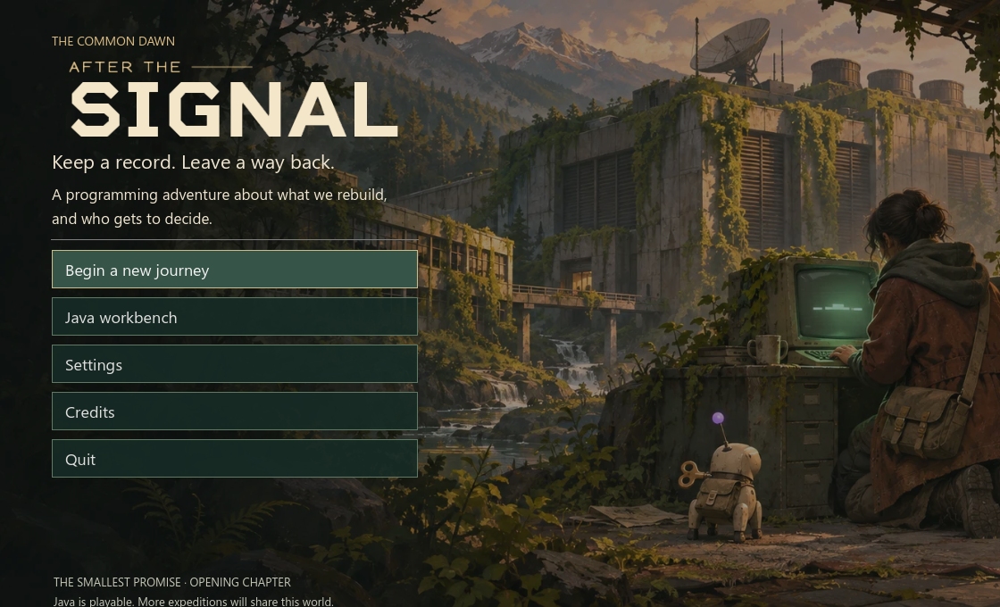

# After the Signal


After the Signal is a free, MIT-licensed, offline programming adventure. You learn Java by bringing a ruined settlement's machines back to life: one instruction, then a method, then the data structures the settlement actually needs.

The opening chapter, **The Smallest Promise**, is playable now. You name the protagonist, choose a study goal, and make a promise to Rook. That promise changes the conversation later. The Java course beside it is a full local curriculum, graded by a JDK on your machine.



## Highlights

- **216 campaign levels**, taught in order. Write Java, pass the current level, and the next one opens. Eight early chapters end in a graded field repair.
- **359 coding exercises** in the same workbench: guided lessons, campaign problems, drills, and 15 standalone Exercism adaptations, including four optional Java library labs.
- **Three stars a round.** One for passing every test, a second for solving without the reference, and a third for the Big-O bonus. Replays keep your best score.
- **98 narrated lessons**, each with a Kokoro recording and a transcript. The first 12 lessons, and the input and receipt levels, also have runnable demonstrations.
- **The First Ruin**, a small 3D chapter. Collect Mara's note, press E at Terminal 01, and pass Level 1 inside the game. A correct submission lights the screen. F2 opens the full workbench from anywhere.
- **Practice tools:** 68 memory cards, a Java scratchpad, a growth lab, and timed sessions.
- **Seven companions**, recruited with stars.
- Local by design. No account and no API key. Drafts, stars, and story choices stay on the device.

## Tech stack

| Layer | Stack |
| --- | --- |
| Workbench | Node.js 22, vanilla ES modules, CodeMirror 6, esbuild |
| Java runner | JDK 17 or newer. The project checks use Temurin 21. Learner code is compiled with `javac` in a temporary directory, with time and output limits. |
| Desktop shell | Tauri 2 (Rust). The Windows build produces an NSIS installer. |
| Story world | Godot 4.7 and GDScript. On Windows, Godot WRY embeds the workbench in the game window. |
| Packages | pnpm 11.25 |

The browser workbench, the Tauri app, and the Godot chapter share one course. Their saves stay in separate profiles.

## Play

### Windows story preview

[Download the Windows story preview](https://github.com/NoticedXAaryan/after-the-signal/releases/tag/v0.1.0-story-preview).

Extract the portable package and open **Play After the Signal.cmd**. Godot and Node are included. You also need a JDK 17 or newer and the Windows WebView2 Runtime. Begin a journey from the title, choose a name and a goal, then meet Mara and Rook.

| Key | Action |
| --- | --- |
| WASD or arrows | Walk. Hold Shift to move faster. |
| E | Read, talk, or use the terminal. |
| F2 | Open or leave the full Java workbench. |
| J | Open the journal. |
| Esc | Pause. |

The walkthrough is in [Play in Godot](docs/play-in-godot.md).

### Workbench from this checkout

1. Install [Node.js 22+](https://nodejs.org/) and a [JDK 17 or newer](https://adoptium.net/temurin/releases/?version=21).
2. Install pnpm 11.25 if you do not already have it (`corepack enable`, or the package manager pinned in `package.json`).
3. Run `pnpm install --frozen-lockfile`.
4. Open **Start After the Signal.cmd**, or run `pnpm start`, and use [the local workbench](http://127.0.0.1:4173).

**Start Java DSA Lab.cmd** opens the same workbench. Choose **Start Level 1**, run the worked example, then write and check your own code. **Review Level 1** returns to the introduction when a save already exists.

Run only Java you wrote or trust. It executes with your user account's permissions. Optional LeetCode and Java reference links open in the browser.

## Develop

Install Node.js 22+, a JDK 17+, pnpm 11.25, Rust 1.85 or newer, and the [Tauri v2 prerequisites](https://v2.tauri.app/start/prerequisites/). The Windows installer also needs MSVC, WebView2, and NSIS.

```powershell
pnpm install --frozen-lockfile
pnpm run check
pnpm start
pnpm run desktop:dev
pnpm run desktop:build
```

`pnpm run check` compiles every reference solution. The current suite is 1,016 cases across 359 exercises, 10 growth comparisons, and checks for a compile error, a timeout, a wrong answer, and a passing submission.

The story check runs in Godot 4.7 with an isolated profile and `AFTER_SIGNAL_TEST_RUN=1`:

```powershell
godot --headless --path world --script scripts/check-story.gd
```

It covers the three opening promises, save and continue, unknown future story IDs, loading, pause and resume, the journal, and returning to the title. Point it at a temporary profile, never a player's save. See [scripts/check-story.gd](scripts/check-story.gd).

GitHub Actions runs the install, the Java suite, and the story check on Windows. The NSIS installer is produced under `src-tauri/target/release/bundle/nsis`. A portable game folder is built on 64-bit Windows with `node scripts/build-game.mjs`.

## Status

**Playable in this repository**

- The Java path, from a first `println` through object-oriented Java and data structures and algorithms.
- The browser workbench and the Tauri desktop workbench, each with its own local save.
- The opening chapter in Godot: title, loading, dialogue, journal, and a walk to Terminal 01. Story choices are stored on the device.

**Planned**

- Later acts as places you can walk through, starting with the water-controller crisis.
- Rust and Python course tracks, attached by the same track and capability IDs. Java is the only playable track today.
- Save transfer between the browser, Tauri, and game profiles.
- Grounded character art, camera collision, controller remapping, and broader accessibility.
- Optional model-written NPC lines, with an explicit provider choice and a spending cap. The current dialogue is authored and stays offline.
- Multiplayer.

## Read next

- [Java syllabus and pacing](docs/curriculum-pacing.md)
- [Story bible](docs/story-bible.md) — campaign spoilers, and a clear line between playable and planned acts
- [Workboard](docs/WORKBOARD.md)
- [Brand](docs/brand-identity.md), [design guide](docs/design-system.md), and [runtime notes](docs/open-source-runtime.md)
- [Contributing](CONTRIBUTING.md)
- [Third-party notices](THIRD-PARTY-NOTICES.md)
