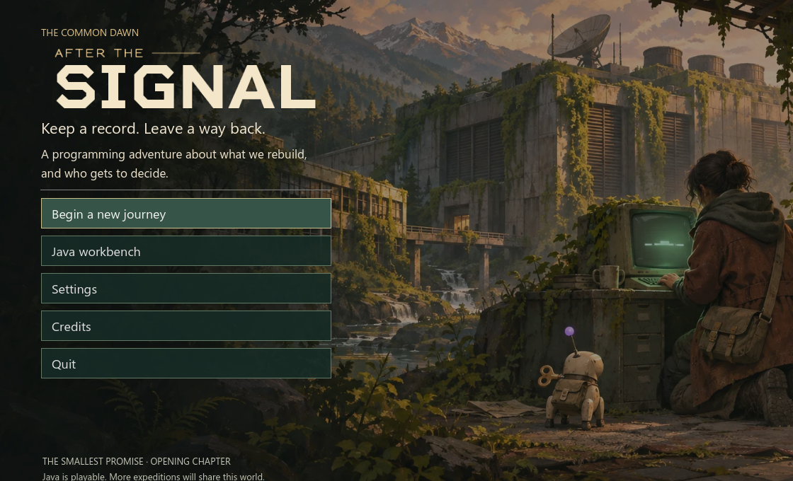

# After the Signal


After the Signal is a free, MIT-licensed desktop game for learning to program. The first course starts with Java fundamentals, moves through object-oriented Java, and finishes with data structures and algorithms.

The first story chapter, **The Smallest Promise**, now has a title screen, real loading transition, a named protagonist, three study goals, branching conversations, a journal, and local saves. Your promises affect how Rook responds to you. The planned campaign follows a community rebuilding machines, networks, and eventually a bounded learning system.

Java is the playable language. Rust, Python, later story acts, and optional AI-generated NPC phrasing are planned. The current story runs offline with authored consequences and no API key.



## Play on Windows

[Download the Windows story preview](https://github.com/NoticedXAaryan/after-the-signal/releases/tag/v0.1.0-story-preview).

For the 3D game, extract the portable package and open **Play After the Signal.cmd**. It includes the Godot and Node runtimes. It requires a Java JDK 17+ and Windows WebView2. Begin a journey from the title, choose a name and a goal, then meet Mara and Rook. Press **E** to interact, **F2** for the full Java workbench, **J** for the journal, or **Esc** to pause. See [play in Godot](docs/play-in-godot.md).

For the standalone workbench:

1. Install Node.js 22+ and a [JDK 17 or newer](https://adoptium.net/temurin/releases/?version=21).
2. From this checkout, run `pnpm install --frozen-lockfile`, then double-click **Start Java DSA Lab.cmd**.
3. Choose **Start Level 1**, run the worked example, then write and check your own code. If you already have a save, use **Review Level 1** to revisit the new introduction.

The game and Java engine run locally. Drafts and progress stay in the application profile. The optional LeetCode and Java reference links open in your browser. Run Java code you wrote or trust because it executes with your user account's permissions.

## What you can play

- **216 campaign levels.** Eight foundation chapters each culminate in a graded field repair. Learn in order, write Java, and pass the current level to unlock the next one.
- **Three stars per round.** Earn one by passing all tests, a second by solving without the reference, and a third by answering the Big-O bonus. Replay rounds to improve your best score.
- **359 coding exercises.** Open practice includes 15 standalone Exercism adaptations, including four optional Java library labs, in addition to the campaign lessons, problems, and drills.
- **Offline narration for 98 guided lessons.** Play, pause, or seek in a Kokoro recording, or open the matching transcript. The first 12 lessons and the input and receipt levels also have runnable demonstrations.
- **3D First Ruin.** Get Mara's note from the courier, then press E at the terminal to open Level 1 inside the game. Passing Java submissions light the screen and finish the receipt repair. Press F2 anywhere to use the full workbench.
- **Practice tools.** Use 68 memory cards, the Java sandbox, the growth lab, and timed sessions to work on specific skills.
- **Seven companions.** Unlock cats, dogs, wizards, and a suspiciously sentient cup of coffee by collecting stars.

## Develop

Install Node.js 22+, a JDK 17+, and the [Tauri v2 prerequisites](https://v2.tauri.app/start/prerequisites/). The Windows build uses Rust, MSVC, WebView2, and NSIS.

```powershell
pnpm install --frozen-lockfile
pnpm run check
pnpm run desktop:dev
pnpm run desktop:build
```

The Windows installer is built under `src-tauri/target/release/bundle/nsis`. For browser development, use `pnpm start` and open [the local web preview](http://127.0.0.1:4173). Browser and desktop saves live in separate profiles.

See the [Java syllabus and pacing](docs/curriculum-pacing.md), [brand identity](docs/brand-identity.md), [Contributing](CONTRIBUTING.md), the [design guide](docs/design-system.md), [runtime research](docs/open-source-runtime.md), the [First Ruin workboard](docs/first-ruin.md), and [third-party notices](THIRD-PARTY-NOTICES.md).
