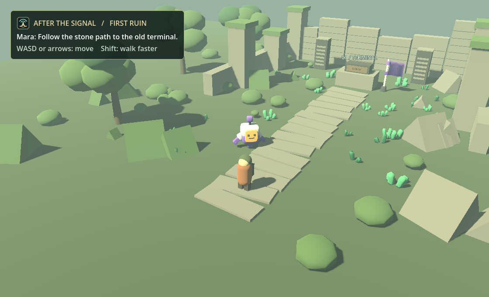

# First Ruin workboard

The player grew up in Cairn, a village that records deliveries and water levels by hand. The only working screen is in a ruined office. Mara asks the player to make it print a message before they trust it with the cistern. The player can finish that interaction with one Java statement.

Use [Genshin Impact's gameplay trailer](https://genshin.hoyoverse.com/en/news/detail/5775) as a reference for exploration and how landscapes direct attention. Use the supplied fieldbook references for the workbench. After the Signal's art direction is original: faded concrete, climbing plants, sunlit stone, brass hardware, and cool terminal light. A bright landmark should make the route readable before a quest marker is needed.

For implementation references, start with [Godot's third-person demo](https://github.com/godotengine/tps-demo) for follow-camera and character animation patterns and the [official demo projects](https://github.com/godotengine/godot-demo-projects) for smaller, isolated examples. Check each asset's license before importing it.

## Playable now

- Run `Play After the Signal.cmd` on Windows. The portable build supplies Godot and Node. The launcher starts a local Java workbench for the duration of the game.
- Move with WASD or arrow keys. Hold Shift to move faster. Press E near Mara's wind-up courier to read her note. Approach Terminal 01 and press E to open the Level 1 briefing inside the game window.
- Read or listen to the lesson. Predict an output, run an example, then edit the starter and use **Check level**. Return to Godot to see the screen light up and display READY.
- Press E again to resume the level path. F2 opens the full workbench anywhere, including Open Practice. Finish **Print a supply receipt** at the end of First steps. The screen then displays RECORDED and its sign changes to RESTORED.
- Choose **Return to ruin** or press F2 to walk again. The game uses a local WebView2 profile for stars and drafts. The standalone browser and Tauri editions retain separate profiles.
- The courier and foliage use [Kenney's CC0 models](../THIRD-PARTY-NOTICES.md#exploration). The terminal and ruins are original.

## Next slice

| Deliverable | What makes it ready |
| --- | --- |
| Character and ruin art | Build out the explorer model and office props. The courier already uses a licensed animated model, and the path uses licensed foliage and a flag. |
| Camera and controls | Follow camera with collision, mouse and controller controls, remapping, and an option to reduce camera movement. Keep text and prompts legible at smaller desktop sizes. |
| One complete mission | The in-game repair works. Next, add a follow-up conversation with Mara and teach the second machine from the same room. |
| Save transfer | Add an optional import from the standalone browser or Tauri workbench. The local game bridge already exposes only terminal and receipt completion. |
| Progression beyond the room | Branching, loops and arrays repair the cistern. Later regions unlock systems topics and projects. Revisit worlds without losing stars or breaking the next-level order. |
| Release | The portable Windows folder includes Godot and Node. A signed installer or smaller dedicated Godot export is a future release task. |

This build has one explorable room with a two-stage repair and the complete Java workbench. Multiplayer remains deferred.
